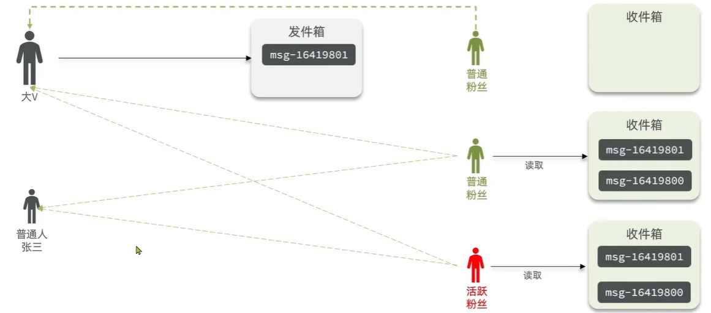

# 好友关注

## 关注和取关

在探店笔记详情页，用户可以关注笔记作者，关注后按钮显示为“已关注”；再次点击则取消关注。进入详情页时，还需要查询当前用户是否已关注该作者，以便展示正确的按钮状态。

**核心需求：**

1. **关注/取关用户**：根据前端传入的目标状态，新增或删除关注关系
2. **判断是否关注**：查询当前登录用户是否关注了指定用户，返回布尔值
3. **防止重复关注**：同一个用户对同一个作者最多保留一条关注记录

### 数据库设计

#### 数据表结构

`tb_follow` 是保存用户关注关系的中间表，结构如下：

```sql
CREATE TABLE `tb_follow` (
    `id` bigint unsigned NOT NULL AUTO_INCREMENT COMMENT '主键',
    `user_id` bigint unsigned NOT NULL COMMENT '关注者用户 ID',
    `follow_user_id` bigint unsigned NOT NULL COMMENT '被关注者用户 ID',
    `create_time` timestamp NOT NULL DEFAULT CURRENT_TIMESTAMP COMMENT '关注时间',
    PRIMARY KEY (`id`),
    UNIQUE KEY `uk_user_follow` (`user_id`, `follow_user_id`),
    KEY `idx_follow_user` (`follow_user_id`)
) ENGINE=InnoDB DEFAULT CHARSET=utf8mb4 COMMENT='用户关注关系表';
```

用户之间的关注是**多对多关系**，表中 `user_id` 和 `follow_user_id` 分别表示关注者与被关注者。

**索引说明：**

- **联合唯一索引** `uk_user_follow(user_id, follow_user_id)`：防止重复关注，同时支持查询关注列表和关注状态。
- **普通索引** `idx_follow_user(follow_user_id)`：支持查询某位用户的粉丝列表。

#### 实体类设计

使用 `Follow` 实体类映射 `tb_follow`，其中 `userId` 和 `followUserId` 分别对应关注者与被关注者，`createTime` 记录关注时间。

```java
@Data
@TableName("tb_follow")
public class Follow {

    @TableId(type = IdType.AUTO)
    private Long id;
    private Long userId;          // 当前登录用户，即关注者
    private Long followUserId;    // 被关注的用户
    private LocalDateTime createTime;
}
```

### 关注/取关用户

#### 接口说明

根据前端传入的目标状态，新增或删除当前用户对指定用户的关注关系。

| 项目 | 内容 |
|------|------|
| 请求方式 | PUT |
| 请求路径 | `/follow/{followUserId}/{isFollow}` |
| 请求参数 | `followUserId`（被关注用户 ID）、`isFollow`（目标关注状态），均为路径参数 |
| 返回结果 | `Result` 对象，表示操作是否成功 |

`followUserId` 在笔记详情页中取自 `blog.userId`；`isFollow` 为 `true` 表示关注，为 `false` 表示取关。

#### 实现思路

1. 从 `UserHolder` 获取当前登录用户 ID
2. `isFollow` 为 `true` 时，新增关注记录
3. `isFollow` 为 `false` 时，按关注者和被关注者 ID 删除关注记录

#### 代码实现

两个接口均沿用 [短信登录](./sms-login.md) 中的 `UserHolder` 和统一返回对象 `Result`，由登录拦截器校验登录状态。以下代码省略常规 import。

::: tip 教程示例说明

本节只展示关注关系的新增、删除和查询，默认用户已登录、参数和目标用户有效。参数校验、禁止关注自己、重复请求及异常处理等细节，在实际项目中再补充；联合唯一索引会阻止重复记录，但示例未将重复关注的异常转换为成功响应。

:::

**Controller 层：**

```java
@RestController
@RequestMapping("/follow")
public class FollowController {

    @Resource
    private IFollowService followService;

    /**
     * 关注/取关用户
     */
    @PutMapping("/{followUserId}/{isFollow}")
    public Result follow(@PathVariable("followUserId") Long followUserId,
                         @PathVariable("isFollow") Boolean isFollow) {
        return followService.follow(followUserId, isFollow);
    }
}
```

**Mapper 接口：**

```java
@Mapper
public interface FollowMapper extends BaseMapper<Follow> {
}
```

**Service 接口：**

```java
public interface IFollowService extends IService<Follow> {

    Result follow(Long followUserId, Boolean isFollow);
}
```

**Service 层：**

`FollowServiceImpl` 继承 MyBatis-Plus 的 `ServiceImpl`，使用 `save()` 新增关系、`remove()` 删除关系。

```java
@Service
public class FollowServiceImpl extends ServiceImpl<FollowMapper, Follow>
        implements IFollowService {

    @Override
    public Result follow(Long followUserId, Boolean isFollow) {
        // 1. 获取当前登录用户 ID
        Long userId = UserHolder.getUser().getId();

        if (isFollow) {
            // 2. 关注：保存关注关系
            Follow follow = new Follow();
            follow.setUserId(userId);
            follow.setFollowUserId(followUserId);
            follow.setCreateTime(LocalDateTime.now());
            save(follow);
        } else {
            // 3. 取关：删除当前用户对目标用户的关注关系
            remove(new LambdaQueryWrapper<Follow>()
                .eq(Follow::getUserId, userId)
                .eq(Follow::getFollowUserId, followUserId));
        }

        return Result.ok();
    }
}
```

**关键实现点：**

1. **关注者来自登录上下文**：`userId` 从 `UserHolder` 获取，前端只传目标用户 ID
2. **取关同时匹配双方 ID**：只删除当前用户对指定用户的关注关系

### 判断是否关注

#### 接口说明

进入笔记详情页时，查询当前登录用户是否关注了笔记作者，供前端展示“关注”或“已关注”按钮。

| 项目 | 内容 |
|------|------|
| 请求方式 | GET |
| 请求路径 | `/follow/or/not/{followUserId}` |
| 请求参数 | `followUserId`（被关注用户 ID，取自 `blog.userId`），为路径参数 |
| 返回结果 | `Result` 对象，`data` 为 `true`（已关注）或 `false`（未关注） |

#### 实现思路

1. 获取当前登录用户 ID
2. 按 `user_id` 和 `follow_user_id` 查询 `tb_follow` 中是否存在关注记录
3. 存在则返回 `true`，不存在则返回 `false`

#### 代码实现

在上一小节的 Controller 和 Service 中补充查询方法，复用已有的 `FollowMapper`。

**Controller 层：**

在 `FollowController` 中增加以下方法：

```java
/**
 * 判断当前用户是否关注了指定用户
 */
@GetMapping("/or/not/{followUserId}")
public Result isFollow(@PathVariable("followUserId") Long followUserId) {
    return followService.isFollow(followUserId);
}
```

**Service 接口：**

在 `IFollowService` 中增加方法声明：

```java
Result isFollow(Long followUserId);
```

**Service 层：**

在 `FollowServiceImpl` 中增加以下方法，使用 `count()` 判断关系是否存在：

```java
@Override
public Result isFollow(Long followUserId) {
    // 1. 获取当前登录用户 ID
    Long userId = UserHolder.getUser().getId();

    // 2. 查询当前用户与目标用户之间是否存在关注关系
    long count = count(new LambdaQueryWrapper<Follow>()
        .eq(Follow::getUserId, userId)
        .eq(Follow::getFollowUserId, followUserId));

    // 3. 返回布尔值，供前端展示关注状态
    return Result.ok(count > 0);
}
```

本节先通过 MySQL 查询关注状态。后续实现“共同关注”时，可以引入 Redis Set，通过集合交集查询共同关注的用户。

## 共同关注

在个人主页，用户可以查看与当前登录用户的共同关注列表，即双方都关注的用户。使用 Redis 的 Set 数据结构，可以高效地计算集合交集，避免 MySQL 中的复杂联表查询。

**核心需求：**

1. **查询共同关注列表**：返回当前登录用户与指定用户共同关注的所有用户信息
2. **高性能交集计算**：利用 Redis Set 的 `SINTER` 命令，在 O(N) 时间内完成交集运算
3. **双写一致性**：关注/取关操作需要同步更新 MySQL 和 Redis

### 设计方案

#### 数据结构选型

使用 **Redis Set** 存储每个用户的关注列表，key 为 `follow:userId:{userId}`，value 为被关注者的 ID 集合。

**选择 Set 的理由：**

- **去重性**：Set 自动去重，天然符合关注关系的唯一性要求
- **交集运算**：Redis 提供 `SINTER` 命令，可直接计算多个集合的交集
- **高效查询**：时间复杂度为 O(N)，N 为最小集合的元素个数

**数据示例：**

```
follow:userId:1 → {2, 3, 5, 8}   // 用户 1 关注了用户 2、3、5、8
follow:userId:2 → {3, 5, 9}      // 用户 2 关注了用户 3、5、9
```

查询用户 1 和用户 2 的共同关注：`SINTER follow:userId:1 follow:userId:2` → `{3, 5}`

#### 双写策略

在关注/取关操作中，同时更新 MySQL 和 Redis：

1. **关注时**：向 MySQL 插入关注记录，同时执行 `SADD follow:userId:{userId} {followUserId}`
2. **取关时**：从 MySQL 删除关注记录，同时执行 `SREM follow:userId:{userId} {followUserId}`

::: warning 数据一致性
本节采用**先写 MySQL 再写 Redis** 的策略，未处理 Redis 写入失败的补偿逻辑。生产环境中需要考虑分布式事务或最终一致性方案（如消息队列异步同步、定时任务校验等），防止双写不一致导致的脏数据。
:::

### 改造关注/取关接口

修改之前的 `follow()` 方法，在 MySQL 操作后同步更新 Redis。

在 `FollowServiceImpl` 中注入 `StringRedisTemplate`，并修改 `follow()` 方法：

```java
@Service
public class FollowServiceImpl extends ServiceImpl<FollowMapper, Follow>
        implements IFollowService {

    @Resource
    private StringRedisTemplate stringRedisTemplate;

    @Override
    public Result follow(Long followUserId, Boolean isFollow) {
        // 1. 获取当前登录用户 ID
        Long userId = UserHolder.getUser().getId();
        String key = "follow:userId:" + userId;

        if (isFollow) {
            // 2. 关注：保存关注关系到 MySQL
            Follow follow = new Follow();
            follow.setUserId(userId);
            follow.setFollowUserId(followUserId);
            follow.setCreateTime(LocalDateTime.now());
            boolean success = save(follow);

            // 3. 同步写入 Redis Set
            if (success) {
                stringRedisTemplate.opsForSet().add(key, followUserId.toString());
            }
        } else {
            // 4. 取关：从 MySQL 删除关注关系
            boolean success = remove(new LambdaQueryWrapper<Follow>()
                .eq(Follow::getUserId, userId)
                .eq(Follow::getFollowUserId, followUserId));

            // 5. 同步删除 Redis 中的成员
            if (success) {
                stringRedisTemplate.opsForSet().remove(key, followUserId.toString());
            }
        }

        return Result.ok();
    }

    // ... isFollow() 方法保持不变
}
```

**关键实现点：**

1. **Key 设计**：使用 `follow:userId:{userId}` 作为 Set 的 key，明确表示该集合存储的是用户关注的其他用户 ID
2. **Value 类型**：存储 `followUserId` 的字符串形式，因为 `StringRedisTemplate` 默认操作 String 类型
3. **双写顺序**：先写 MySQL（保证持久化），再写 Redis（保证缓存一致性）

### 查询共同关注列表

#### 接口说明

查询当前登录用户与指定用户的共同关注列表，返回用户详细信息。

| 项目 | 内容 |
|------|------|
| 请求方式 | GET |
| 请求路径 | `/follow/common/{targetUserId}` |
| 请求参数 | `targetUserId`（目标用户 ID），为路径参数 |
| 返回结果 | `Result` 对象，`data` 为共同关注的用户列表（`List<UserDTO>`） |

#### 实现思路

1. 获取当前登录用户 ID
2. 使用 Redis 的 `SINTER` 命令计算两个用户的关注集合的交集
3. 根据交集中的用户 ID，从数据库查询用户详细信息
4. 返回用户列表

#### 代码实现

**Controller 层：**

在 `FollowController` 中增加以下方法：

```java
/**
 * 查询共同关注列表
 */
@GetMapping("/common/{targetUserId}")
public Result followCommons(@PathVariable("targetUserId") Long targetUserId) {
    return followService.followCommons(targetUserId);
}
```

**Service 接口：**

在 `IFollowService` 中增加方法声明：

```java
Result followCommons(Long targetUserId);
```

**Service 层：**

在 `FollowServiceImpl` 中增加以下方法：

```java
@Resource
private IUserService userService;

@Override
public Result followCommons(Long targetUserId) {
    // 1. 获取当前登录用户 ID
    Long userId = UserHolder.getUser().getId();
    String key1 = "follow:userId:" + userId;
    String key2 = "follow:userId:" + targetUserId;

    // 2. 使用 Redis Set 的交集命令，求出共同关注的用户 ID
    Set<String> intersect = stringRedisTemplate.opsForSet().intersect(key1, key2);

    // 3. 如果交集为空，直接返回空列表
    if (intersect == null || intersect.isEmpty()) {
        return Result.ok(Collections.emptyList());
    }

    // 4. 将 String 类型的 ID 转换为 Long 类型
    List<Long> ids = intersect.stream()
        .map(Long::valueOf)
        .collect(Collectors.toList());

    // 5. 根据 ID 列表查询用户信息
    List<UserDTO> users = userService.listByIds(ids)
        .stream()
        .map(user -> BeanUtil.copyProperties(user, UserDTO.class))
        .collect(Collectors.toList());

    return Result.ok(users);
}
```

**关键实现点：**

1. **交集运算**：`stringRedisTemplate.opsForSet().intersect(key1, key2)` 对应 Redis 的 `SINTER` 命令
2. **空值处理**：如果两个用户没有共同关注，直接返回空列表，避免后续无效查询
3. **类型转换**：Redis Set 存储的是 String 类型，查询数据库前需要转换为 Long
4. **批量查询优化**：使用 `listByIds()` 批量查询，避免 N+1 查询问题
5. **DTO 转换**：使用 `UserDTO` 返回用户信息，避免暴露敏感字段（如密码）

::: tip UserDTO 说明
`UserDTO` 是用户实体的数据传输对象，通常只包含 `id`、`nickName`、`icon` 等前端需要的字段。示例假设项目中已定义 `UserDTO` 和 `IUserService`，实际使用时需根据项目结构调整。
:::


## 关注推送

关注推送也叫 Feed 流，直译为**投喂**，为用户持续提供"沉浸式"的内容体验。通过无限下拉刷新获取新信息，是社交产品的核心功能之一。

- **传统模式**：用户主动检索信息（搜索驱动）
- **Feed 模式**：内容主动匹配用户（推荐驱动）

### Feed 流的两种模式

Feed 流产品有两种常见的内容组织模式：

#### 1. Timeline（时间线模式）

不做内容筛选，简单按照内容发布时间排序，常用于好友或关注场景。

**典型产品：** 微信朋友圈、微博关注页

**优点：**
- 信息全面，不会有遗漏
- 实现相对简单，逻辑清晰

**缺点：**
- 信息噪音较多，用户不一定感兴趣
- 内容获取效率低，需要手动筛选

#### 2. 智能排序（推荐算法模式）

利用智能算法屏蔽违规内容和用户不感兴趣的内容，主动推送用户可能感兴趣的信息。

**典型产品：** 抖音、今日头条、小红书发现页

**优点：**
- 精准投喂用户感兴趣的信息
- 用户粘度高，容易产生沉浸式体验

**缺点：**
- 算法不精准时可能起到反作用
- 实现复杂，需要大量数据和算法支持

::: tip 本节方案选择
本例中的个人页面是基于关注的好友来做 Feed 流，因此采用 **Timeline 模式**，按照发布时间倒序展示关注用户的最新笔记。
:::

### Feed 流的实现方案

Feed 流的实现方案有三种，分别对应不同的读写策略：

|  | 别名 | 写操作成本 | 读操作成本 | 用户读取延迟 | 实现难度 | 适用场景 |
|---------|------|----------|----------|------------|---------|---------|
| **拉模式** | 读扩散 | 低 | 高 | 高 | 简单 | 很少使用（性能差） |
| **推模式** | 写扩散 | 高 | 低 | 低 | 简单 | 用户量少、没有大 V |
| **推拉结合** | 读写混合 | 中 | 中 | 低 | 很复杂 | 千万级用户量、有大 V |

#### 1. 拉模式（读扩散）

**核心思想：** 用户读取 Feed 时，临时拉取关注用户的最新内容并合并排序。

**实现流程：**

1. 用户请求 Feed 流
2. 查询当前用户的关注列表
3. 遍历关注列表，查询每个关注用户的最新内容
4. 合并所有内容并按时间排序
5. 返回前 N 条

**优缺点分析：**

- ✅ 写入简单，发布内容时只需保存到自己的发件箱
- ❌ 读取慢，需要查询多个用户的内容并排序
- ❌ 关注用户越多，查询越慢（典型的 N+1 查询问题）

::: tip 什么是 N+1 查询问题？

**N+1 查询问题** 是数据库查询中的经典性能陷阱，指的是：为了获取一批关联数据，先执行 1 次主查询获取 N 条记录，然后针对每条记录再执行 1 次子查询，总共执行了 **1 + N** 次数据库查询。

**示例场景：**

假设用户关注了 100 个人，使用拉模式获取 Feed 流时：

```java
// 1 次查询：获取关注列表
List<Long> followIds = getFollowList(userId);  // 返回 100 个用户 ID

// N 次查询：分别获取每个用户的最新笔记
List<Blog> feedList = new ArrayList<>();
for (Long followId : followIds) {
    Blog blog = getBlogByUserId(followId);  // 执行 100 次数据库查询！
    feedList.add(blog);
}
```

这样就产生了 **1 + 100 = 101 次数据库查询**，性能极差。

**解决方案：**

1. **批量查询（IN 查询）**：
   ```java
   // 1 次主查询 + 1 次批量查询 = 2 次
   List<Long> followIds = getFollowList(userId);
   List<Blog> blogs = blogMapper.selectList(
       new LambdaQueryWrapper<Blog>()
           .in(Blog::getUserId, followIds)
   );
   ```

2. **联表查询（JOIN）**：
   ```sql
   SELECT b.* FROM tb_blog b
   INNER JOIN tb_follow f ON b.user_id = f.follow_user_id
   WHERE f.user_id = #{userId}
   ORDER BY b.create_time DESC
   ```

3. **缓存预计算（推模式）**：提前将内容推送到用户的收件箱，读取时无需关联查询。

本节采用的推模式就是为了避免 N+1 查询问题，通过写时预计算换取读时的高性能。
:::

#### 2. 推模式（写扩散）

**核心思想：** 用户发布内容时，主动推送到所有粉丝的收件箱。

**实现流程：**

1. 用户发布内容
2. 查询该用户的所有粉丝
3. 将内容推送到每个粉丝的收件箱（Feed 队列）
4. 用户读取 Feed 时，直接从自己的收件箱获取

**优缺点分析：**

- ✅ 读取快，直接从自己的收件箱获取
- ✅ 无需复杂的多表联查和排序
- ❌ 写入慢，粉丝越多，推送成本越高
- ❌ 大 V（百万粉丝）发一条内容需要写入百万次

**存储结构示例（Redis）：**

```
feed:userId:1 → [blogId:100, blogId:99, blogId:95, ...]  // 用户 1 的收件箱
feed:userId:2 → [blogId:100, blogId:98, blogId:96, ...]  // 用户 2 的收件箱
```

#### 3. 推拉结合（读写混合）

**核心思想：** 普通用户采用推模式，大 V 采用拉模式。

**实现流程：**

1. 用户发布内容时：
   - 如果是普通用户（粉丝 < 阈值），推送到所有粉丝的收件箱
   - 如果是大 V（粉丝 ≥ 阈值），只保存到自己的发件箱
2. 用户读取 Feed 时：
   - 先从自己的收件箱读取普通用户的内容
   - 再主动拉取关注的大 V 的最新内容
   - 合并排序后返回



**优缺点分析：**

- ✅ 兼顾读写性能，适合大规模应用
- ✅ 普通用户读取快，大 V 写入快
- ❌ 实现复杂，需要维护用户等级和双重存储逻辑
- ❌ 需要动态调整阈值和策略

**适用场景：** 微博、B 站等千万级用户的社交平台


### 基于推模式实现关注推送

前面已经了解了三种 Feed 流实现方案，本节将具体实现基于推模式的关注推送功能。原因如下：

1. **实现简单**：读取逻辑清晰，无需复杂的多表联查
2. **读取性能优秀**：用户刷新 Feed 时直接从 Redis 收件箱获取，延迟极低
3. **场景匹配**：教学项目用户量小，没有大 V，推模式的写入成本可接受

::: warning 生产环境建议
推模式适合中小规模应用。如果遇到大 V（百万粉丝）或用户量激增，发布一条内容需要写入百万次，会导致严重的性能问题。此时应考虑升级为**推拉结合模式**。
:::

#### 核心需求

1. **发布推送**：用户发布探店笔记时，将笔记 ID 推送到所有粉丝的收件箱
2. **时间排序**：收件箱中的笔记按照发布时间倒序排列，最新的在最前面
3. **分页查询**：用户查询 Feed 流时，支持滚动分页加载

#### 数据结构

推模式需要为每个用户维护一个收件箱，存储关注用户推送的笔记 ID。Redis 提供了两种可选的数据结构：**List** 和 **Sorted Set（ZSet）**。

本节选择 **Sorted Set（ZSet）**，原因如下：

1. **天然支持排序**：使用发布时间戳作为 score，自动按时间倒序排列
2. **支持滚动分页**：可以通过 score（时间戳）实现基于时间的游标分页
3. **自动去重**：同一篇笔记不会重复出现在收件箱中（虽然实际场景中重复推送的可能性低）

**存储结构设计：**

```
Key: feed:userId:{userId}
Type: ZSet
Member: blogId（笔记 ID）
Score: timestamp（发布时间戳，毫秒级）

示例：
feed:userId:1 → {(blogId:100, 1697520000000), (blogId:99, 1697519000000), ...}
```

使用 `ZADD` 推送笔记，使用 `ZREVRANGEBYSCORE` 按时间倒序查询（最新的在前）。

#### 改造发布笔记接口

修改 [发布探店笔记](./blogger-follow.md#发布笔记接口) 中的 `saveBlog()` 方法，在保存笔记到数据库后，推送到所有粉丝的收件箱。

```java
@Override
public Result saveBlog(Blog blog) {
    // 1. 获取当前登录用户
    UserDTO user = UserHolder.getUser();
    blog.setUserId(user.getId());

    // 2. 保存笔记到数据库
    boolean success = save(blog);
    if (!success) {
        return Result.fail("发布笔记失败！");
    }

    // 3. 查询当前用户的所有粉丝
    List<Follow> follows = followService.query()
        .eq("follow_user_id", user.getId())
        .list();

    // 4. 推送笔记 ID 到所有粉丝的收件箱
    for (Follow follow : follows) {
        // 粉丝的收件箱 key
        String key = "feed:userId:" + follow.getUserId();
        // 使用当前时间戳作为 score，笔记 ID 作为 member
        stringRedisTemplate.opsForZSet().add(key, blog.getId().toString(), System.currentTimeMillis());
    }

    // 5. 返回笔记 ID
    return Result.ok(blog.getId());
}
```

**关键实现点：**

1. **查询粉丝列表**：通过 `follow_user_id = 当前用户ID` 查询所有粉丝
2. **ZSet 推送**：使用 `ZADD` 将笔记 ID 存入粉丝的收件箱，score 为当前时间戳

::: warning 性能优化建议
当前实现是**同步推送**，如果某个用户有数万粉丝，发布笔记会非常慢。生产环境中建议：

1. **异步推送**：将推送任务放入消息队列（RabbitMQ、Kafka），由消费者异步处理
2. **批量操作**：使用 Redis Pipeline 批量写入，减少网络开销
3. **限流保护**：对大 V 的推送进行限流，防止 Redis 压力过大
:::


#### 滚动分页查询

在个人主页的关注卡片中，查询并展示推送的 Blog 信息。

Feed 流的数据会不断更新，数据的角标也在不断变化，传统的分页方式（基于页码或偏移量）会导致**数据重复或遗漏**问题，因此需要采用滚动分页方案。

:::tip 传统分页为什么会导致数据重复或遗漏
传统分页使用 `LIMIT offset, size` 基于**位置偏移**查询数据，在 Feed 流这种动态数据场景下会出现问题。

**举个例子：**

收件箱有 10 条笔记（时间戳 1-10，数字越大越新），每页显示 5 条，按时间倒序排列。

1. **第 1 页**：`LIMIT 0, 5` 查询到时间戳 10, 9, 8, 7, 6 的笔记
2. 此时有 1 条新笔记（时间戳 11）发布
3. **第 2 页**：`LIMIT 5, 5` 本想查询剩余的 5 条笔记

**问题出现：**

新笔记插入后，收件箱变成：11, 10, 9, 8, 7, 6, 5, 4, 3, 2, 1

`LIMIT 5, 5` 跳过前 5 条（时间戳 11, 10, 9, 8, 7），查询到的是：**时间戳 6, 5, 4, 3, 2**

结果：
- **时间戳 6 重复了**（第 1 页已经看过）
- **时间戳 1 遗漏了**（永远看不到）

**根本原因：** 传统分页依赖位置索引，而新数据插入会导致所有数据位置后移。

**滚动分页的解决方案：** 第 1 页记录最后一条的时间戳 6，第 2 页查询"时间戳 < 6 的数据"，返回时间戳 5, 4, 3, 2, 1。无论新数据如何插入，查询条件始终是"< 6"，不会重复也不会遗漏。
:::

##### 接口设计

| 项目 | 内容 |
|------|------|
| 请求方式 | GET |
| 请求路径 | `/blog/of/follow` |
| 请求参数 | `lastId`（上次查询的最小时间戳，首次传当前时间戳）<br>`offset`（偏移量，默认 0） |
| 返回结果 | `Result` 对象，`data` 为 `ScrollResult` |

**返回数据结构：**

```java
@Data
public class ScrollResult {
    private List<?> list;       // 笔记列表
    private Long minTime;       // 本次查询的最小时间戳
    private Integer offset;     // 偏移量（同一时间戳下的偏移）
}
```

**参数设计说明：**

接口使用 Redis 的 `ZREVRANGEBYSCORE` 命令实现滚动分页：

```bash
ZREVRANGEBYSCORE key max min WITHSCORES LIMIT offset count

# 首次查询：获取当前时间之前的最新 5 条笔记
ZREVRANGEBYSCORE feed:userId:1 1697520000000 0 WITHSCORES LIMIT 0 5

# 第 2 页：lastId 为上次的最小时间戳 1697510000000，offset 为 0
ZREVRANGEBYSCORE feed:userId:1 1697510000000 0 WITHSCORES LIMIT 0 5

# 处理同一时间戳：如果上次最小时间戳为 1697510000000，且有 3 条相同时间戳的笔记
# 此时 lastId 仍为 1697510000000，offset 为 3（跳过已读取的 3 条）
ZREVRANGEBYSCORE feed:userId:1 1697510000000 0 WITHSCORES LIMIT 3 5
```

参数映射关系：

| 接口参数 | Redis 参数 | 说明 |
|---------|-----------|------|
| `lastId` | `max` | 上次查询的最小时间戳，作为本次查询的上限。首次查询传当前时间戳 |
| `offset` | `offset` | 偏移量，用于跳过同一时间戳下已读取的数据。取值为上次结果中与最小时间戳相同的元素个数 |
| - | `min` | 固定为 `0`，表示查询时间戳的下限 |
| - | `count` | 固定为 `5`，表示每页返回的笔记条数 |

##### 实现思路

1. 获取当前登录用户的收件箱 key：`feed:userId:{userId}`
2. 使用 Redis 的 `ZREVRANGEBYSCORE` 命令查询 score ≤ lastId 的前 N 条数据
3. 解析查询结果，记录最小时间戳和 offset（处理同一时间戳的情况）
4. 根据笔记 ID 列表查询数据库，获取笔记详情
5. 补充笔记作者信息（昵称、头像）
6. 封装返回结果（笔记列表、minTime、offset）

##### 代码实现

**Controller 层：**

在 `BlogController` 中增加以下方法：

```java
/**
 * 查询关注用户的 Feed 流（滚动分页）
 */
@GetMapping("/of/follow")
public Result queryBlogOfFollow(
    @RequestParam("lastId") Long lastId,
    @RequestParam(value = "offset", defaultValue = "0") Integer offset) {
    return blogService.queryBlogOfFollow(lastId, offset);
}
```

**Service 接口：**

在 `IBlogService` 中增加方法声明：

```java
Result queryBlogOfFollow(Long lastId, Integer offset);
```

**Service 层：**

在 `BlogServiceImpl` 中增加以下方法：

```java
@Override
public Result queryBlogOfFollow(Long lastId, Integer offset) {
    // 1. 获取当前登录用户
    Long userId = UserHolder.getUser().getId();
    String key = "feed:userId:" + userId;

    // 2. 查询收件箱：ZREVRANGEBYSCORE key max min LIMIT offset count
    Set<ZSetOperations.TypedTuple<String>> typedTuples = stringRedisTemplate.opsForZSet()
        .reverseRangeByScoreWithScores(key, 0, lastId, offset, 3);

    // 3. 判断是否为空
    if (typedTuples == null || typedTuples.isEmpty()) {
        return Result.ok();
    }

    // 4. 解析数据：blogId、minTime（最小时间戳）、offset（偏移量）
    List<Long> ids = new ArrayList<>(typedTuples.size());
    long minTime = 0;  // 记录本次查询的最小时间戳
    int newOffset = 1; // 记录与最小时间戳相同的元素个数

    for (ZSetOperations.TypedTuple<String> tuple : typedTuples) {
        // 获取笔记 ID
        ids.add(Long.valueOf(tuple.getValue()));
        // 获取分数（时间戳）
        long time = tuple.getScore().longValue();

        // 记录最小时间戳
        if (time == minTime) {
            // 如果与上一个时间戳相同，offset 加 1
            newOffset++;
        } else {
            // 如果是新的更小的时间戳，重置 offset
            minTime = time;
            newOffset = 1;
        }
    }

    // 5. 根据 ID 查询笔记详情
    String idStr = StrUtil.join(",", ids);
    List<Blog> blogs = query().in("id", ids).last("ORDER BY FIELD(id," + idStr + ")").list();

    // 6. 查询笔记作者信息
    for (Blog blog : blogs) {
        // 查询用户信息
        User user = userService.getById(blog.getUserId());
        blog.setName(user.getNickName());
        blog.setIcon(user.getIcon());
        // 查询当前用户是否点赞过该笔记（如果有点赞功能）
        // isBlogLiked(blog);
    }

    // 7. 封装返回结果
    ScrollResult result = new ScrollResult();
    result.setList(blogs);
    result.setMinTime(minTime);
    result.setOffset(newOffset);

    return Result.ok(result);
}
```

**关键实现点：**

1. **滚动分页查询**：
   - 使用 `reverseRangeByScoreWithScores()` 查询 score ≤ lastId 的前 N 条数据
   - `reverseRange` 表示倒序（从大到小），最新的笔记在前
   - `WithScores` 表示同时返回 member 和 score

2. **处理同一时间戳**：
   - 如果多个笔记的发布时间戳相同，需要使用 offset 区分
   - 记录最小时间戳以及与该时间戳相同的元素个数

3. **保持查询顺序**：
   - Redis 返回的数据已按 score 排序
   - MySQL 查询时使用 `ORDER BY FIELD(id, ...)` 保持相同的顺序

::: tip offset 的作用
`offset` 用于处理**同一时间戳**下的分页问题。

**场景：** 假设有 5 条笔记的时间戳都是 `1697520000000`，首次查询返回 3 条，则：
- `minTime = 1697520000000`
- `offset = 3`

下次查询时，传入 `lastId = 1697520000000, offset = 3`，会跳过前 3 条，返回剩余 2 条。
:::
